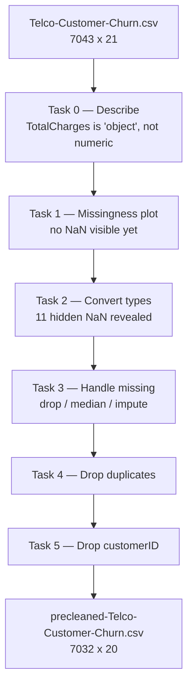
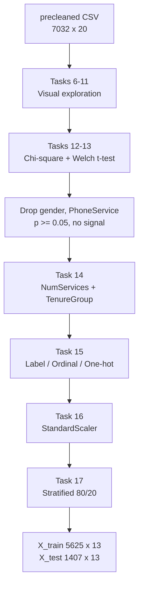
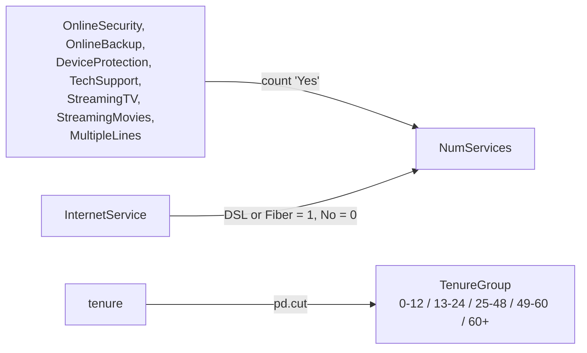

# Data Preparation and Visualization

End-to-end data preparation pipeline for the **Telco Customer Churn** dataset:
from a raw CSV with hidden missing values to a clean, encoded, scaled and
stratified train/test split ready for machine learning.

> Holberton School · `holbertonschool-modern_ai` · `data_analysis/data_preparation_visualization`

---

## Table of contents

- [Overview](#overview)
- [Dataset](#dataset)
- [Pipeline](#pipeline)
- [Project structure](#project-structure)
- [Tasks](#tasks)
- [Phase 1 — Data cleaning (0–5)](#phase-1--data-cleaning-05)
- [Phase 2 — Visual exploration (6–11)](#phase-2--visual-exploration-611)
- [Phase 3 — Statistical testing (12–13)](#phase-3--statistical-testing-1213)
- [Phase 4 — Modeling preparation (14–17)](#phase-4--modeling-preparation-1417)
- [Feature engineering](#feature-engineering)
- [Encoding scheme](#encoding-scheme)
- [Key findings](#key-findings)
- [Decision log](#decision-log)
- [Technical notes on plot matching](#technical-notes-on-plot-matching)
- [Requirements](#requirements)
- [Usage](#usage)
- [Author](#author)

---

## Overview

A telecom company loses customers. Which ones, and why? This project answers
that question in four stages: it cleans a messy dataset, explores it visually,
confirms the findings with statistical tests, and turns the result into numeric
features a model can learn from.

The deliverable is not a model. It is the groundwork a model needs: every
decision about dropping, filling, binning and encoding is made explicitly and
justified by evidence rather than habit.

**Churn** means a customer left the service. It is the target variable.

---

## Dataset

| File | Used by | Shape | Notes |
|------|---------|-------|-------|
| `Telco-Customer-Churn.csv` | Tasks 0–5 | 7043 × 21 | Raw. `TotalCharges` stored as text, 11 blank strings hide as valid values |
| `precleaned-Telco-Customer-Churn.csv` | Tasks 6–17 | 7032 × 20 | Output of Task 5 |

### Columns

| Column | Type | Description |
|--------|------|-------------|
| `customerID` | object | Unique identifier (dropped in Task 5) |
| `gender` | object | Male / Female |
| `SeniorCitizen` | int → object | 0/1, mapped to No/Yes in Task 2 |
| `Partner` | object | Has a partner |
| `Dependents` | object | Has dependents |
| `tenure` | int | Months with the company |
| `PhoneService` | object | Has phone service |
| `MultipleLines` | object | Yes / No / No phone service |
| `InternetService` | object | DSL / Fiber optic / No |
| `OnlineSecurity` | object | Yes / No / No internet service |
| `OnlineBackup` | object | Yes / No / No internet service |
| `DeviceProtection` | object | Yes / No / No internet service |
| `TechSupport` | object | Yes / No / No internet service |
| `StreamingTV` | object | Yes / No / No internet service |
| `StreamingMovies` | object | Yes / No / No internet service |
| `Contract` | object | Month-to-month / One year / Two year |
| `PaperlessBilling` | object | Yes / No |
| `PaymentMethod` | object | Four payment types |
| `MonthlyCharges` | float | Current monthly bill |
| `TotalCharges` | object → float | Lifetime charges, converted in Task 2 |
| `Churn` | object | **Target**: did the customer leave |

---

## Pipeline

### Stage 1 — from raw to clean



### Stage 2 — from clean to model-ready



---

## Project structure
data_analysis/data_preparation_visualization/
├── 0-describe_data.py # shape, dtypes, missing, duplicates
├── 1-plot_missingness.py # missingness scatter plot
├── 2-convert_columns.py # type conversion
├── 3-clean_total_charges.py # drop / median / impute
├── 4-remove_duplicates.py # deduplicate
├── 5-drop_customerID.py # drop the identifier
├── 6-plot_churn_distribution.py # target distribution
├── 7-plot_categorical_distributions.py # grid of categorical bars
├── 8-plot_continuous_distributions.py # histogram + KDE + boxplot
├── 9-plot_correlation_heatmap.py # correlation matrix
├── 10-plot_categorical_vs_churn.py # churn rate per category
├── 11-plot_numeric_vs_churn.py # numeric distribution by churn
├── 12-chi_square_tests.py # independence tests
├── 13-ttest_numeric.py # Welch’s t-tests
├── 14-create_features.py # NumServices, TenureGroup
├── 15-encode_features.py # encoding for modeling
├── 16-scale_numeric.py # standardization
├── 17-split_data.py # stratified train/test split
└── README.md

---

## Tasks

| # | File | Function | What it does |
|---|------|----------|--------------|
| 0 | `0-describe_data.py` | *(script, exactly 13 lines)* | Shape, dtypes, head, missing counts, duplicates |
| 1 | `1-plot_missingness.py` | `plot_missingness(df)` | Scatter plot: one vertical mark per missing value |
| 2 | `2-convert_columns.py` | `convert_columns(df)` | `TotalCharges` → numeric, `SeniorCitizen` → No/Yes |
| 3 | `3-clean_total_charges.py` | `clean_total_charges(df, method)` | Three strategies for missing values |
| 4 | `4-remove_duplicates.py` | `remove_duplicates(df)` | Drop duplicate rows |
| 5 | `5-drop_customerID.py` | `drop_customerID(df)` | Remove the unique identifier |
| 6 | `6-plot_churn_distribution.py` | `plot_churn_distribution(df)` | Target class balance |
| 7 | `7-plot_categorical_distributions.py` | `plot_categorical_distributions(df, cols)` | 16 categorical features in a 6×3 grid |
| 8 | `8-plot_continuous_distributions.py` | `plot_continuous_distributions(df, cols)` | Histogram + KDE and boxplot per numeric column |
| 9 | `9-plot_correlation_heatmap.py` | `plot_correlation_heatmap(df)` | Annotated correlation matrix |
| 10 | `10-plot_categorical_vs_churn.py` | `plot_categorical_vs_churn(df, col)` | Churn rate per category |
| 11 | `11-plot_numeric_vs_churn.py` | `plot_numeric_vs_churn(df, col)` | Numeric distribution split by churn |
| 12 | `12-chi_square_tests.py` | `chi_square_tests(df)` | p-value per categorical feature |
| 13 | `13-ttest_numeric.py` | `ttest_numeric(df)` | p-value per numeric feature |
| 14 | `14-create_features.py` | `create_features(df)` | `NumServices` and `TenureGroup` |
| 15 | `15-encode_features.py` | `encode_features(df)` | Label, ordinal and one-hot encoding |
| 16 | `16-scale_numeric.py` | `scale_numeric(df)` | Standardize to mean 0, std 1 |
| 17 | `17-split_data.py` | `split_data(df, ...)` | Stratified 80/20 split |

---

## Phase 1 — Data cleaning (0–5)

The dataset looks clean and is not. `df.isnull().sum()` returns zero for every
column, yet 11 rows carry a blank string `' '` in `TotalCharges`. Pandas reads
that column as `object` and never flags it.

The sequence matters:

1. **Describe** the data and notice `TotalCharges` is `object` while it should
   be a number.
2. **Plot missingness** — an empty plot, which proves only that pandas sees no
   `NaN`, not that the data is complete.
3. **Convert** with `pd.to_numeric(..., errors='coerce')`. The blanks become
   `NaN` and the missingness plot now shows 11 marks.
4. **Handle** them. All 11 rows share `tenure = 0` and `Churn = 'No'`: brand new
   customers who have not been billed yet. Three strategies are implemented;
   `impute` (`MonthlyCharges × tenure`) returns `0.0`, which is the honest value.
5. **Deduplicate** (none here, but the step belongs in any pipeline).
6. **Drop `customerID`** — 7032 unique values carry no predictive signal and
   invite memorization.

---

## Phase 2 — Visual exploration (6–11)

| Plot | What it reveals |
|------|-----------------|
| Churn distribution | Class imbalance: ~73% No, ~27% Yes |
| Categorical grid | `PhoneService` is ~90% "Yes" — near-zero variance |
| Continuous distributions | `tenure` and `TotalCharges` heavily right-skewed |
| Correlation heatmap | `tenure` ↔ `TotalCharges` = 0.83 (multicollinearity) |
| Churn rate per category | `gender` gives 26.2% vs 26.95% — no signal |
| Numeric vs churn | Churners concentrate below 12 months of tenure |

Visual exploration generates hypotheses. It does not confirm them — that is
Phase 3's job.

---

## Phase 3 — Statistical testing (12–13)

**Chi-square** tests whether a categorical feature and `Churn` are independent.
**Welch's t-test** tests whether a numeric feature has different means across
the two churn groups. Welch is used instead of the standard t-test because the
groups differ in size (1869 vs 5163) and variance.

Selected p-values:

| Feature | Test | p-value | Verdict |
|---------|------|---------|---------|
| `Contract` | chi-square | 7.3e-257 | Strongest categorical signal |
| `OnlineSecurity` | chi-square | 1.4e-184 | Strong |
| `TechSupport` | chi-square | 7.4e-180 | Strong |
| `MultipleLines` | chi-square | 0.0036 | Weak but significant |
| `PhoneService` | chi-square | **0.350** | **No signal → dropped** |
| `gender` | chi-square | **0.490** | **No signal → dropped** |
| `tenure` | Welch t-test | 2.3e-234 | Strongest numeric signal |
| `TotalCharges` | Welch t-test | 1.2e-75 | Strong |
| `MonthlyCharges` | Welch t-test | 2.7e-72 | Strong |

Threshold: `p < 0.05` means the relationship is statistically significant.

---

## Phase 4 — Modeling preparation (14–17)

1. **Feature engineering** — collapse nine service columns into one count, and
   bin `tenure` into intervals.
2. **Encoding** — turn every category into a number, with the right encoder for
   the right kind of variable.
3. **Scaling** — `MonthlyCharges` spans 18–119 while `TotalCharges` spans
   0–8700. Without standardization, distance- and gradient-based algorithms
   would weight the second far more heavily.
4. **Splitting** — 80/20, stratified so both sets keep the same ~26.6% churn
   rate. Without `stratify`, a random split could skew the test set and make
   the evaluation meaningless.

---

## Feature engineering



`PhoneService` is deliberately excluded from the `NumServices` count: it was
dropped in Phase 3 for lack of signal.

`pd.cut` excludes the left edge and includes the right, giving `(0, 12]`,
`(12, 24]`, `(24, 48]`, `(48, 60]`, `(60, inf)` — exactly the intervals the
task specifies, with `0` excluded.

Churn rate by tenure group:

| Group | Churn rate |
|-------|-----------|
| 0–12 | ~48% |
| 13–24 | ~29% |
| 25–48 | ~20% |
| 49–60 | ~14% |
| 60+ | ~7% |

The first year is the retention-critical window.

---

## Encoding scheme

| Column(s) | Encoder | Result |
|-----------|---------|--------|
| `Churn` | `LabelEncoder` | No → 0, Yes → 1 |
| `Partner`, `Dependents`, `PaperlessBilling`, `SeniorCitizen` | `OrdinalEncoder(categories=[["No","Yes"]])` | No → 0, Yes → 1 |
| `Contract`, `PaymentMethod` | `pd.get_dummies(drop_first=True)` | One column per category minus the first |
| `TenureGroup` | `OrdinalEncoder()` | Alphabetical, which matches the natural order |

`drop_first=True` removes the redundant column: when all the others are zero,
the dropped category is implied. Keeping it would introduce perfect
multicollinearity.

The function returns the three fitted encoders alongside the DataFrame so the
same mapping can be applied to new data later.

---

## Key findings

- The dataset is **imbalanced**: ~73% of customers stay, ~27% churn.
- **Tenure is the strongest predictor.** Churn drops from ~48% in the first year
  to ~7% after five years.
- **Contract type** has the strongest statistical relationship with churn
  (p ≈ 7e-257). Month-to-month customers are far more exposed.
- **`gender` and `PhoneService` carry no signal** (p ≥ 0.05) and were removed.
- `tenure` and `TotalCharges` correlate at **0.83** — overlapping information
  worth keeping in mind during modeling.
- The 11 rows with missing `TotalCharges` were all `tenure = 0` and all
  `Churn = 'No'`: new subscribers not yet billed.

---

## Decision log

| Decision | Reason | Evidence |
|----------|--------|----------|
| Convert `TotalCharges` with `errors='coerce'` | Blank strings hide as valid values | Task 0 showed dtype `object` |
| Impute missing `TotalCharges` as `MonthlyCharges × tenure` | All affected rows have `tenure = 0` | Task 2 test output |
| Drop `customerID` | 7032 unique values, no predictive content | Domain reasoning |
| Drop `gender` | No difference in churn rate | p = 0.490 (chi-square) |
| Drop `PhoneService` | Near-zero variance, no churn difference | p = 0.350 (chi-square) |
| Keep all three numeric features | All differ significantly across churn groups | p < 1e-71 (Welch) |
| Collapse service columns into `NumServices` | Nine correlated binary columns → one ordinal count | Correlation structure |
| Bin `tenure` into `TenureGroup` | Churn relationship is non-linear | p ≈ 3e-189 (chi-square) |
| Stratify the split | 27% minority class | Class imbalance from Task 6 |

---

## Technical notes on plot matching

Tasks 6, 7, 8, 10 and 11 are graded by comparing the produced figure against a
reference image. A difference invisible to the eye still fails the check with
`The plot does not match the reference`. Five causes, all of which had to be
found the hard way:

**1. matplotlib version.** The checker runs **3.10.0**. Testing locally with a
different version produces slightly different figures and sends you chasing
phantom bugs.

```bash
pip install --break-system-packages "matplotlib==3.10.0"
```

**2. pandas `.plot()` vs matplotlib `bar()`.** `df[col].value_counts().plot(kind='bar')`
draws bars of width **0.5** and silently adds the column name as an x-axis
label. `plt.bar()` / `ax.bar()` uses width **0.8** and adds nothing. The
references use matplotlib.

**3. KDE resolution.** In Task 8 the KDE curve is evaluated at
`np.linspace(min, max, N)`. With `N = 100`, `200` or `1000` the curve looks
identical but the rendered pixels differ. The correct value is **200**.

**4. Extra labels.** A `plt.xlabel()` that the task never asked for is enough to
fail the check. Add only what the specification names.

**5. Empty grid cells.** A 6×3 grid holding 16 plots leaves two empty cells.
They must be removed with `fig.delaxes()`, otherwise they render as blank axes
with 0.0–1.0 ticks.

### When guessing stops working

Download the reference image from the intranet and diff it:

```python
from PIL import Image
import numpy as np

a = Image.open('Task_7.png').convert('RGB')
b = Image.open('reference.png').convert('RGB')
print(a.size, b.size)
if a.size == b.size:
    d = np.abs(np.array(a).astype(int) - np.array(b).astype(int)).sum(2)
    ys, xs = np.where(d > 10)
    print('differing pixels:', len(ys))
    Image.fromarray(((d > 10) * 255).astype('uint8')).save('diff.png')
```

White regions in `diff.png` point straight at the element that differs.

---

## Requirements

- Ubuntu 20.04 LTS
- Python 3.11
- pycodestyle 2.14.0

| Package | Version |
|---------|---------|
| numpy | 2.0.2 |
| pandas | 2.2.2 |
| scikit-learn | 1.6.1 |
| matplotlib | 3.10.0 |
| seaborn | 0.13.2 |
| scipy | 1.16.0 |
| pillow | 11.3.0 |

Every file starts with `#!/usr/bin/env python3`, is executable, and carries
module- and function-level docstrings.

---

## Usage

```bash
# style check
python3 -m pycodestyle *.py

# full pipeline, raw CSV to train/test split
python3 - << 'PY'
import pandas as pd

convert_columns     = __import__('2-convert_columns').convert_columns
clean_total_charges = __import__('3-clean_total_charges').clean_total_charges
remove_duplicates   = __import__('4-remove_duplicates').remove_duplicates
drop_customerID     = __import__('5-drop_customerID').drop_customerID
create_features     = __import__('14-create_features').create_features
encode_features     = __import__('15-encode_features').encode_features
scale_numeric       = __import__('16-scale_numeric').scale_numeric
split_data          = __import__('17-split_data').split_data

df = pd.read_csv('Telco-Customer-Churn.csv')
df = convert_columns(df)
df = clean_total_charges(df, method='impute')
df = remove_duplicates(df)
df = drop_customerID(df)
df.to_csv('precleaned-Telco-Customer-Churn.csv', index=False)

df = df.drop(columns=['gender', 'PhoneService'])
df = create_features(df)
df_enc, churn_le, binary_oe, tenure_oe = encode_features(df)
df_scaled = scale_numeric(df_enc)
X_train, X_test, y_train, y_test = split_data(df_scaled)

print('Train:', X_train.shape, '| Test:', X_test.shape)
print('Churn rate — train: %.4f | test: %.4f' % (y_train.mean(), y_test.mean()))
PY
```

Expected output:
Train: (5625, 13) | Test: (1407, 13)
Churn rate — train: 0.2658 | test: 0.2658

---

## Author

**Kleant Laboti** — [github.com/Klei-Laboti](https://github.com/Klei-Laboti)
